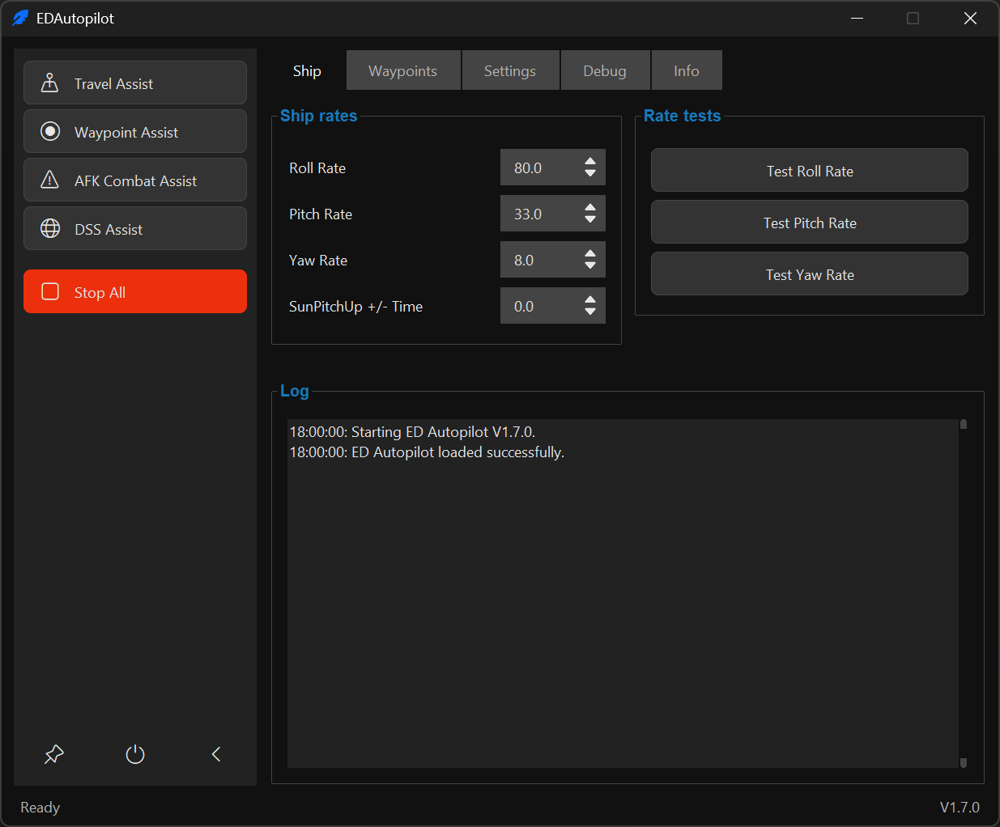
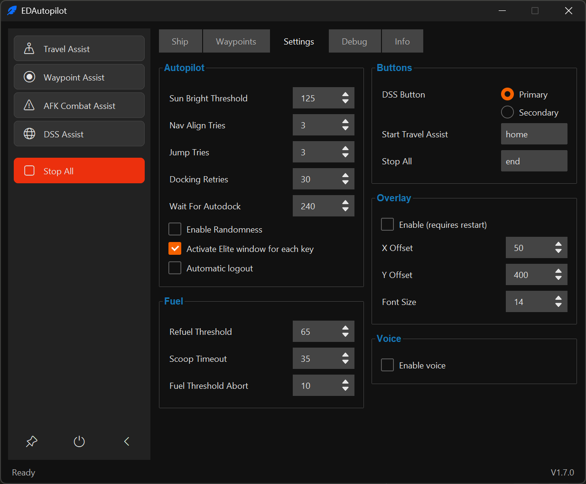
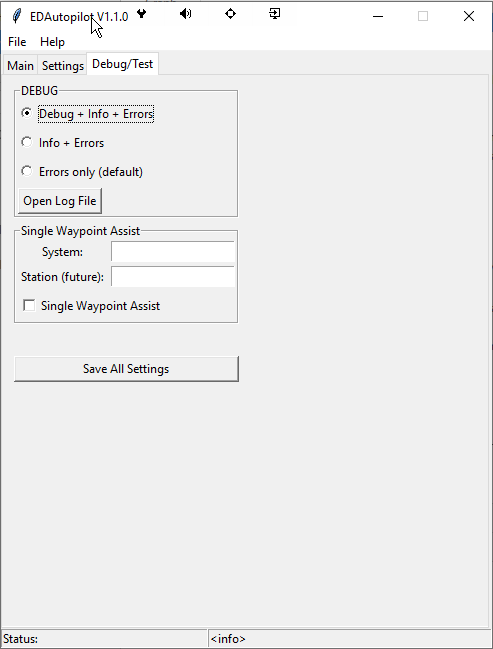

[](https://github.com/DopeEx/EDAPGui/actions/workflows/ci.yml)
[](https://github.com/astral-sh/ruff)
[](.github/workflows/ci.yml)
[](LICENSE)

# EDAPGui

EDAPGui is a Windows autopilot for Elite Dangerous, offering optional assistance features.

## What it can do

- **Travel Assist** follows the route selected in the Galaxy Map, including system scans and fuel management, then
  continues to a selected local target and can request station docking.
- **Waypoint Assist** follows a waypoint file, visits bookmarked destinations, and can dock, trade, or transfer cargo.
- **Single Waypoint Assist** plots and travels to a system entered on the Debug tab.
- **DSS Assist** runs a discovery scan when entering systems in supercruise.
- **AFK Combat Assist** monitors shields and fighter status in a combat zone.
- Optional voice feedback, a debug overlay, and loading a TCE destination are also available.

See the [waypoint guide](docs/Waypoint.md) for waypoint files and trade actions, and the
[ship tuning guide](docs/RollPitchYaw.md) for roll, pitch, and yaw rates.

## Requirements

- Windows
- Elite Dangerous
- Python 3.12 or 3.13 (Python 3.13 is preferred)
- A borderless game window, default HUD colours, and UI brightness of at least 50%
- A docking computer for automatic docking

While an assist is active, keep Elite Dangerous focused and avoid switching to another window, as actions may affect
the currently focused window. A very wide field of view can also make target detection less reliable.

## Install and start

1. Download and extract the repository ZIP, or clone the repository.
2. Run `start_ed_ap.bat`. On first start it creates a private `venv` folder, installs the requirements, and launches
   EDAPGui. Python 3.13 is selected when available; otherwise the installer uses Python 3.12.
3. Start Elite Dangerous and make sure the required keybindings are available. See the
   [keybindings guide](docs/Keybindings.md); `fix_keybinds.bat` can fill missing bindings in a custom preset.
4. In EDAPGui, set the roll, pitch, and yaw rates for the active ship. See the
   [ship tuning guide](docs/RollPitchYaw.md).
5. Select an assist in the main window. The default global hotkeys are **Home** (Travel Assist) and **End** (stop);
   change them in Settings if needed.

The program stores its settings, ship profiles, waypoint files, logs, and debug output in `user_data/`. Example
waypoint files from `data/waypoints/` are copied there on first start. If an existing installation reports an
incompatible virtual environment, remove its `venv` folder and run `install_requirements.bat`.

## Documentation

- [Keybindings and automatic fixer](docs/Keybindings.md)
- [Waypoint files, bookmarks, trading, and transfers](docs/Waypoint.md)
- [Assist workflows: current behavior and design direction](docs/Workflows.md)
- [Ship roll, pitch, and yaw tuning](docs/RollPitchYaw.md)
- [Project structure and development conventions](docs/Structure.md)
- [Changelog](CHANGELOG.md)

## Development

Install the runtime requirements and development tools in the active environment:

```powershell
python -m pip install -r requirements.txt
python -m pip install -r requirements-dev.txt
```

Run the checks used by CI:

```powershell
ruff check .
ruff format --check .
python -m unittest discover -s tests -t .
```

The OCR test requires the full runtime dependencies; it is skipped in CI's slim environment.

## Screenshots

| Main | Settings | Debug |
|---|---|---|
|  |  |  |

## Disclaimer

This repository is provided for educational purposes as a programming example covering file-based data, computer
vision and image matching with OpenCV, voice feedback, Windows integration, threading, and Python classes. Use the
software at your own risk.
