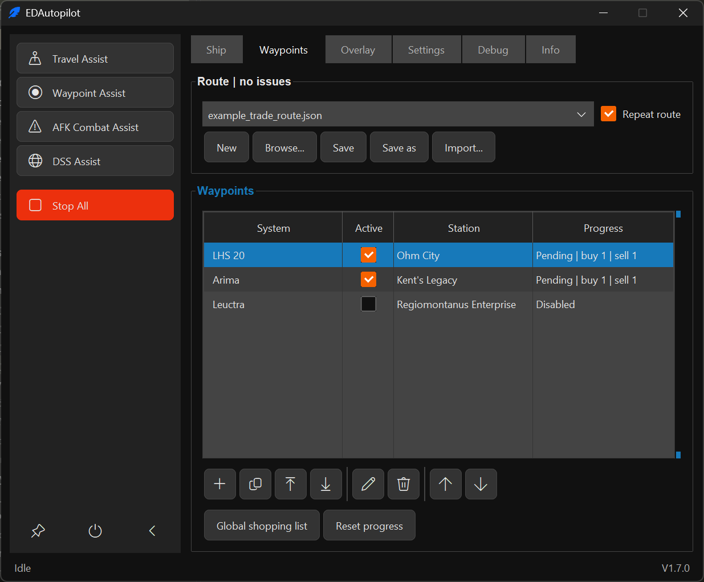
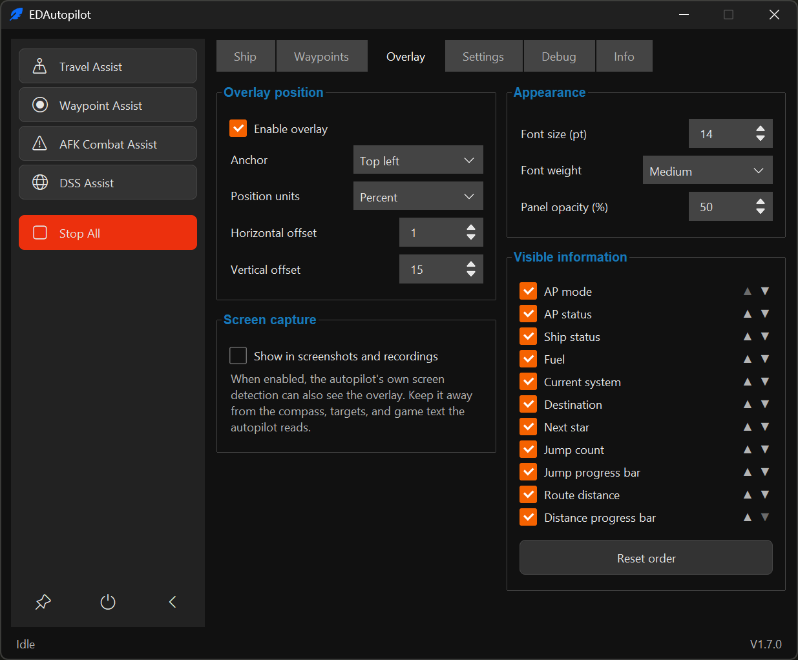
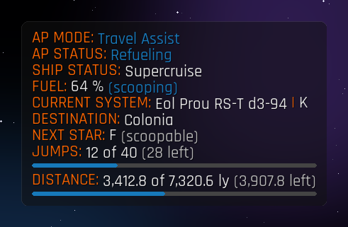
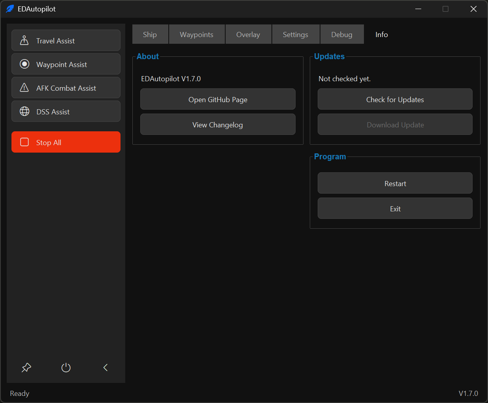
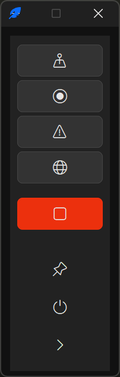

[](https://github.com/DopeEx/EDAPGui/actions/workflows/ci.yml)
[](https://github.com/astral-sh/ruff)
[](.github/workflows/ci.yml)
[](LICENSE)

# EDAPGui

EDAPGui is a Windows autopilot for Elite Dangerous, offering optional assistance features.

## What it can do

- **Travel Assist** follows the route selected in the Galaxy Map, including system scans and fuel management, then
  continues to a local destination reported by the game's `Status.json` and can request station docking. It does not
  infer a local target from the compass when the status has no destination.
- **Waypoint Assist** follows saved routes to systems and stations, with docking, trading, cargo transfers and
  separate progress tracking. It plots Galaxy Map bookmarks first, confirms the system route and falls back to system
  name search if needed. After entering supercruise, it selects and confirms each next jump target before alignment;
  it verifies the selected commodity dialog before submitting a market trade and makes one
  state-checked recovery attempt if the dialog cannot be read.
  After a confirmed sale, it waits for updated cargo data before selecting another trade.
  The **Waypoints** tab offers an integrated route editor, an ID-based commodity catalogue and copied-text trade-route
  import from copied text and Spansh planner files (including Legacy JSON inside the import view), route-level
  repetition, themed activation checkboxes and
  target-only plot buttons. Station-name navigation
  uses name-column OCR when bookmarks are unavailable (no editor warning), selects the first exact name match without a full-list
  rescan, and confirms the selected tab for the standard orange and white/blue
  HUD schemes. See the [waypoint guide](docs/Waypoint.md) for setup, usage and limitations.
- **Single Waypoint Assist** plots and travels to a system entered on the Debug tab.
- **DSS Assist** runs a discovery scan when entering systems in supercruise.
- **AFK Combat Assist** monitors shields and fighter status in a combat zone.
- **Status overlay** shows the assist mode and status, ship status, fuel, current system, route destination, next star,
  jumps, route distance and an optional learned ETA on top of the game, with progress bars for jumps and distance.
  ETA combines remaining system travel time with arrival in your PC's local time; it excludes station travel and trading.
  Its AP status matches the
  main window footer, whose middle shows jumps and route distance while a route assist runs. Position, appearance,
  which lines are shown in which order, and whether screenshots and recordings may include the overlay are set on the
  Overlay tab. By default it stays out of captures; when included, it can also interfere with the autopilot's own
  screen detection.
- **Assist statistics** on the Info tab retain assisted jumps, distance and active time per account and individual ship.
  Ship identity includes both the journal ship ID and type as an additional safeguard.
  Local jump-time history supplies the ETA and survives restarts, with automatic rotating database backups.
  See [statistics and ETA](docs/Workflows.md#assist-statistics-and-eta) for measurement and backup details.
- Optional voice feedback, a debug overlay, and loading a TCE destination are also available.
- **Game language** in Settings follows the game journal automatically or uses a selected language pack. English
  and German are included; additional recognition and commodity translations can be contributed as data-only packs.
  Auto briefly waits for a new journal header on game restart instead of immediately reporting English fallback.
  The application interface remains English. See [game languages](docs/Localization.md).
  Both cockpit panels confirm the selected tab highlight after individual tab switches. Docking requires
  Contacts and carrier deposits require Inventory; an unconfirmed tab stops the action instead of sending blind inputs.
  English/German screenshot tests cover tab recognition for both HUD color schemes.
  Navigation-row recognition also handles long, narrow selected highlights.
  Dim cockpit highlights, including default-orange highlights, use a bounded brightness fallback when normal detection fails.
  Compass marker fallback handles dim HUD markers and hollow markers touching the compass rim,
  with size checks scaled to the compass sphere.

See the [waypoint guide](docs/Waypoint.md) for waypoint files and trade actions, and the
[ship tuning guide](docs/RollPitchYaw.md) for roll, pitch, and yaw rates.
The waypoint guide also explains [first checks and reporting problems](docs/Waypoint.md#manual-validation-and-diagnostics).

## Requirements

- Windows
- Elite Dangerous
- Python 3.12 or 3.13 (recommended download:
  [Python 3.13.17 Windows installer (64-bit)](https://www.python.org/ftp/python/3.13.17/python-3.13.17-amd64.exe))
- A borderless game window, default HUD colours, and UI brightness of at least 50%
- A docking computer for automatic docking

While an assist is active, keep Elite Dangerous focused and avoid switching to another window, as actions may affect
the currently focused window. A very wide field of view can also make target detection less reliable.

## Install and start

1. Download and extract the repository ZIP, or clone the repository.
2. Run `start_ed_ap.bat`. On first start it creates a private `venv` folder, installs the requirements, and launches
   EDAPGui. Python 3.13 is selected when available; otherwise the installer uses Python 3.12.
3. Start Elite Dangerous and make sure the required keybindings are available. See the
   [keybindings guide](docs/Keybindings.md); `fix_keybinds.bat` can fill missing bindings in a custom preset.
4. In EDAPGui, set the roll, pitch, and yaw rates for the active ship. See the
   [ship tuning guide](docs/RollPitchYaw.md).
5. Select an assist in the sidebar of the main window (only one assist runs at a time; **Stop All** safely stops it,
   including while the engine is waiting between actions). The
   default global hotkeys are **Home** (Travel Assist) and **End** (stop); change them in Settings if needed.

The window is always dark and has a fixed size. The arrow at the bottom of the sidebar collapses it to a narrow icon
strip, the pin keeps it on top of other windows, and the power button restarts or exits the program. Changes on the
Ship, Overlay, Settings, and Debug tabs are saved automatically; the lower right corner of the tab shows whether they
are saved. The window position, collapsed state, and pin are remembered in `user_data/configs/gui.json`.

The program stores its settings, ship profiles, waypoint files, route progress, statistics, logs, and debug output in `user_data/`.
Recognition measurements and OCR details are logged only at Debug level. In Debug log mode, recognition problems can
save local diagnostic images, including same-frame compass and target context, alongside a separate detailed log; see the
[assist troubleshooting guide](docs/Workflows.md#vision-diagnostics).
Four buttons on the Debug tab open individual CV views with dark title bars; X closes each window.
Their images scale proportionally when the windows are resized.
Debug Overlay can be toggled
without restarting; see the troubleshooting guide above for when its markings appear.
Downloaded OCR models and the PaddleX cache are stored in the unversioned `user_data/cache/paddlex/`, outside the
virtual environment. The first OCR run needs internet access to download the required models, including after this
cache-location change. Existing models in the user's `.paddlex` folder are not moved or deleted automatically.
Example waypoint files from `data/waypoints/` are copied there on first start. Only the current v2 schema is executable;
use **Legacy JSON** to import old v1/earlier-v2 destinations and trade lists into a new draft, then review and save it.
If an existing installation reports an incompatible virtual environment, remove its `venv` folder
and run `install_requirements.bat`.

## Documentation

- [Keybindings and automatic fixer](docs/Keybindings.md)
- [Waypoint files, bookmarks, trading, and transfers](docs/Waypoint.md)
- [Game languages and contributing language packs](docs/Localization.md)
- [Assist workflows: current behavior and design direction](docs/Workflows.md)
- [Ship roll, pitch, and yaw tuning](docs/RollPitchYaw.md)
- [Project structure and development conventions](docs/Structure.md)
- [Changelog](CHANGELOG.md)

## Development

Before contributing, read and follow the [project structure and development conventions](docs/Structure.md).

Install the runtime requirements and development tools in the active environment:

```powershell
python -m pip install -r requirements.txt
python -m pip install -r requirements-dev.txt
```

Run the checks used by CI:

```powershell
ruff check .
ruff format --check .
python -m unittest discover -s tests -t .
```

The OCR test requires the full runtime dependencies; it is skipped in CI's slim environment.

## Screenshots

Ship tab:


Waypoints tab:



See the [waypoint guide](docs/Waypoint.md#editor-screenshots) for editing and import screenshots.

Overlay tab:



Status overlay:



Settings tab:


Info tab:



Collapsed to the mode buttons:



## Disclaimer

This repository is provided for educational purposes as a programming example covering file-based data, computer
vision and image matching with OpenCV, voice feedback, Windows integration, threading, and Python classes. Use the
software at your own risk.
