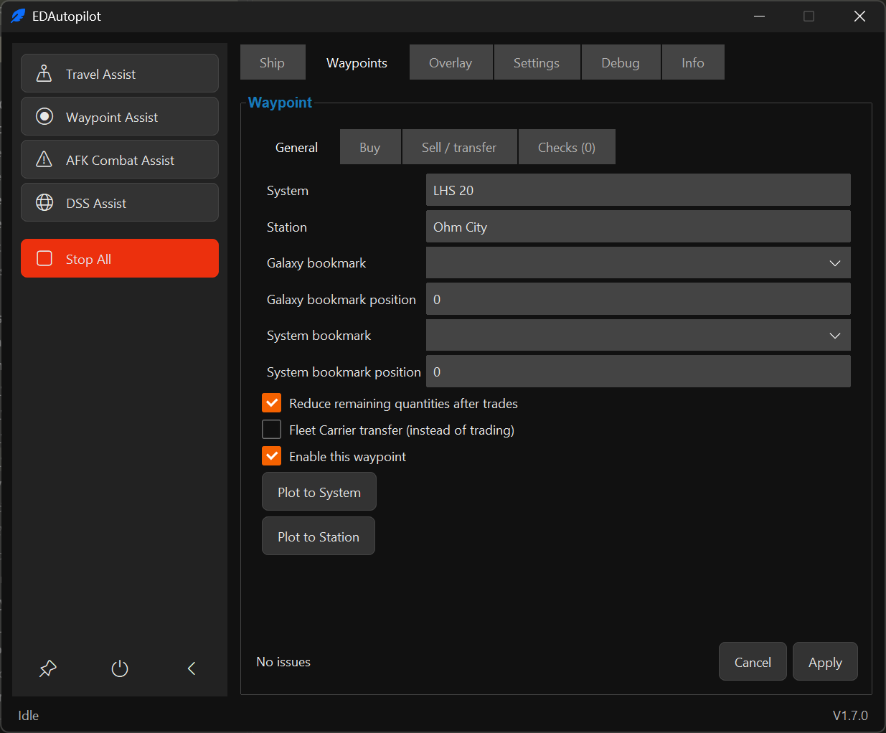
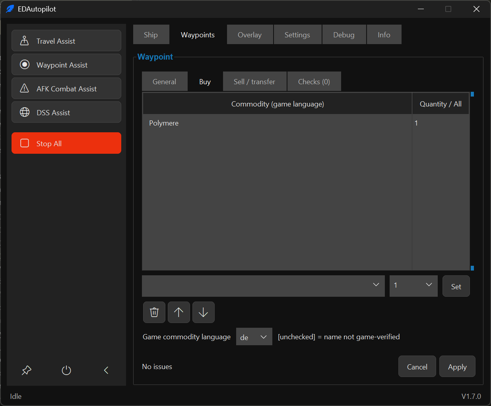
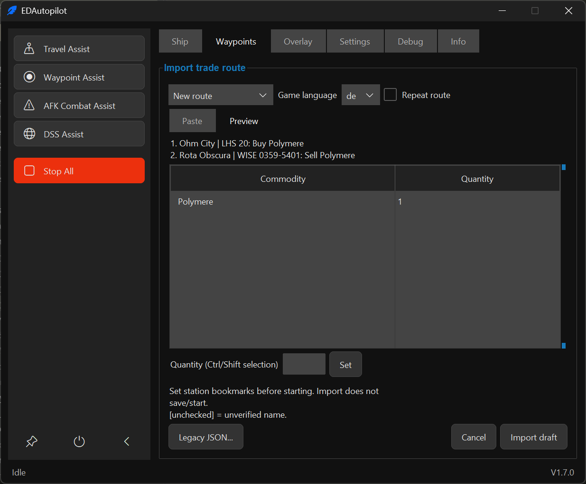

# Waypoint Assist

Waypoint Assist visits the systems and stations in a saved route, in order. It can dock and buy, sell or transfer
cargo at each stop. You create and edit routes in the **Waypoints** tab; you do not need to edit files or know JSON.
The last selected route is loaded again when EDAPGui starts.

## Before you start

- Complete the [installation](../README.md#install-and-start) and check your
  [keybindings](Keybindings.md).
- Fit an automatic docking computer for automatic docking.
- Check the ship's [roll, pitch and yaw settings](RollPitchYaw.md), especially when changing ships.
- Make sure you have enough fuel, credits and free cargo space for the route.
- Check **Settings > Game language** (Auto by default). Routes identify commodities by ID, not translated names.
- Keep Elite Dangerous focused while the assist runs. Do not navigate menus or trade manually at the same time.
- Keep **Stop All** ready. Its default global hotkey is **End**, unless you changed it in Settings.

**Stay at the controls.** A route does not guarantee that a station sells or accepts the requested goods, has a
suitable landing pad, or is safe to visit. Start with a short route and small quantities.

## Create your first route

For a simple first trip, choose a station in your current system and leave trading empty.

1. Open **Waypoints** and choose **New**.
2. Click the **+** button to add a waypoint. Hover over an icon to see its action.
3. On **General**, enter the **System** and **Station** exactly as shown in the game.
   Leave Station empty if you only want to reach a system. Leave System empty to use your current system.
4. For an ordinary station, you can leave both bookmark types empty and both positions at `0`.
   The assist will look for the station in the game's left-hand Navigation panel.
   Check that the panel's filters show the station.
5. Leave **Buy** and **Sell / transfer** empty for this first trip.
6. Choose **Apply** to return to the route list, then **Save** and choose a filename.
7. Leave **Repeat route** off. Start **Waypoint Assist** from the sidebar and return focus to the game.

The assist selects the destination, travels there and docks when a station was requested.
The list shows the waypoint as **Done** when its visit and requested actions are complete.
Without repetition, the assist finishes after the last active waypoint and returns to **Idle**.

## Load and save routes

Use the **Route** dropdown to select a saved route. **Browse...** opens a route stored elsewhere.
Example routes are provided in `data/waypoints/` and copied to `user_data/waypoints/` when missing.
Treat examples as starting points: check their destinations, bookmarks and trades before using them.

| Action | What it does |
|---|---|
| **New** | Starts an empty route. |
| **Save** | Saves changes to the current route. A new route needs a filename first. |
| **Save as** | Saves a separate copy under another filename. |
| **Apply** | Accepts changes in the open form, but does **not** save the route to disk. |
| **Cancel** | Leaves the form without applying its changes. |

An asterisk (`*`) in the route dropdown means there are unsaved changes.
If you switch routes or close the program, EDAPGui asks whether to save or discard them.
Starting an unsaved route also requires saving it first.

**Saving changes to an existing route resets its progress after confirmation.** All stops become pending again,
and requested trade quantities return to the edited values. Saving an unchanged route does not reset progress.

## Edit waypoints

Select a row, then use an icon below the list. Double-clicking a row also opens its editor.

| Action | What it does |
|---|---|
| **Add (+)** | Adds a stop at the end. |
| **Duplicate** | Opens a copy of the selected stop, inserted after it when you choose Apply. |
| **Before / After** | Adds a new stop before or after the selected one. |
| **Edit (pencil)** | Changes the selected stop. |
| **Delete (bin)** | Removes the selected stop after confirmation. |
| **Up / Down** | Changes the order of stops. |

Duplicates copy the destination, options and trade lists, not the original stop's completed progress.

### Active and Repeat route

- **Active:** Click the checkbox in a row to include or exclude that stop. You can also select the row and press
  **Space**. An inactive stop is shown as **Disabled** and skipped. Save the route after changing this setting.
- **Repeat route:** After the last active stop, start again at the first one with the original trade quantities.
  Repetition continues until you stop the assist; a fixed number of repetitions is not currently available.
  Keep an eye on cargo space, credits and stock.

An empty route or a route with no active stops cannot start.
Editing, loading, saving and resetting are locked while Waypoint Assist is running or still stopping.

### Errors and warnings

Red marks indicate an error that must be corrected before saving or starting.
Open the waypoint's **Checks** tab for an explanation. The route heading shows the total number of issues;
click it for details across the route.

Orange marks are warnings. You can save after acknowledging them, but should review the affected settings first.
No bookmark is required for an ordinary station visible in the Navigation panel.

If **Apply** is unavailable, check for errors and unfinished commodity edits: after entering a commodity or quantity,
press **Set** to add it to the list.

These checks do not check live market stock, docking access or the positions of your in-game bookmarks.

## Choosing destinations

### Without bookmarks

For another system, the assist plots a Galaxy Map route using the system name.
After arrival, it looks for the station name in the left-hand **Navigation** panel unless the correct target is
already selected.

The panel search reads the highlighted name from the screen, scrolls through the list and selects the first exact
match. This screen-reading process is called OCR; you do not need to configure it separately for each station.
Long lists can take longer. The search makes at most two attempts within a two-minute search window;
closing the panel and checking the selected target can take additional time.
If the destination cannot be found or confirmed, the assist stops with a message.

**Check your Navigation filters:** the destination must be visible in the list. As an optional optimization, show
only categories that could be stops on your route, such as stations, settlements or Fleet Carriers.
EDAPGui does not change these filters for you. Do not hide a category needed later in the route.

Screen reading depends on resolution, HUD colors and the visible layout. Some icons or destination types may not
be recognized reliably. If a valid destination is repeatedly missed, try a bookmark or report the problem.

### With bookmarks

Bookmarks are optional shortcuts to destinations you have already saved in the game.

1. In the game's Galaxy Map or System Map, find the bookmark and its category.
2. In the waypoint's **General** tab, choose the corresponding bookmark category.
3. Enter its position in that category: `1` for the first bookmark, `2` for the second, and so on.
4. If you do not use a bookmark, leave its type empty and position at `0`.

A **Galaxy bookmark** is tried first when travelling to another system.
If it does not produce the expected route, the assist tries a system-name search.
A **System bookmark** can select a local destination after arrival.
If the correct station is already selected, it is reused.

Bookmark positions depend on your own in-game lists. Check them again if you add, remove or reorder bookmarks.
**Colonisation Ships require a Galaxy Map bookmark.**

### Plot buttons: select a target without flying

In the waypoint editor:

- **Plot to System** selects the system route.
- **Plot to Station** selects the station target.

These buttons use the destination currently entered in the form. They do not save the form, start a flight,
trade or change progress. **Stop All** cancels target selection.

For station-name search or a System Map bookmark, you must already be in the destination system.
To plot a station in another system without travelling there, you need a Galaxy Map station bookmark.

### Target checks during flight

Before each jump, the assist selects and checks the next system on the route, including intermediate systems.
A saved route alone is not enough: the active target must match.
If the target or supercruise state cannot be confirmed, the assist sets throttle to zero and stops with a message
before jump alignment. **Zero throttle in supercruise still means the ship is moving.**

Galaxy Map route selection also has a limited number of retries. If it cannot confirm the requested route,
the assist stops rather than continuing to an unknown destination.

## Buy and sell goods

Open a waypoint and choose **Buy** or **Sell / transfer**.

1. Choose a **Game commodity language** for display and suggestions; the active game language is the default.
2. Click the search field to open suggestions, then type part of a commodity name to narrow the list.
   You can search installed commodity translations or the internal symbol; the selected commodity is stored by ID.
3. Enter a whole-number quantity, or choose **All** for the selected commodity. Use **Enter number...** to reset the
   quantity field to a number after choosing **All**.
4. Press **Set**. Repeat for other goods.
5. Choose **Apply**, then save the route.

Select an existing commodity row to change its quantity with **Set**.
The bin button removes it. **Up / Down** changes its priority.
Changing the display language updates the names of existing rows without changing their identities, quantities or order.

The catalogue offers suggestions, not prices or stock information. `[unchecked]` means the suggested name has
not yet been verified against game market data; it does not mean the commodity is unavailable.
Missing translations display in English. A typed name must resolve uniquely to a known commodity ID; unknown or
ambiguous names cannot be stored as executable trade requests.

The route file remains **v2**. `BuyCommodities` and `SellCommodities` are ordered objects whose keys are decimal
commodity IDs, for example `"BuyCommodities": {"128049152": 20, "128049154": 10}`. The editor order is the trade
order; do not alphabetically sort these keys when editing JSON. See [language packs](Localization.md) to contribute
additional recognition texts and commodity names without changing Python code.

### Trade order and quantities

At each stop, the assist processes:

1. The waypoint's **Sell / transfer** list, from top to bottom.
2. Its **Buy** list, from top to bottom.
3. The enabled **Global shopping list**, from top to bottom.

**All** requests as much of that commodity as possible within the applicable cargo and market limits.
It does not bypass credit, stock or demand restrictions.

With **Reduce remaining quantities after trades** enabled, successful trades reduce the amount still requested.
For example, buying 2 of a requested 5 leaves 3.
This also applies to All: it is stored as a large request of 9999 units, not an unlimited amount.
Repeating or resetting the route restores the original request.

With that option off, each new visit requests the configured amount again.

If a requested sale is not in your hold, it is skipped for that visit. If you have less than requested, only the
available amount is sold. A skipped sale does not reduce its remaining request, but the stop can still finish
after its other actions. The sale is tried again only on another visit, such as a repeat or deliberate reset.

### Global shopping list

Choose **Global shopping list** below the waypoint list and select **Enable this shopping list** to use it.
These purchases are attempted at each supported market after the local Buy list.
Leave it disabled if you only want the trades listed at individual stops.

### Trade safety and interruptions

The assist matches the requested ID to the current market, then checks the game's actual localized commodity
name and whether the dialog is buying or selling before submitting a trade. An English catalogue fallback is only
a display fallback; it never replaces the current market's identity or name.
It then waits for the game's transaction confirmation before reducing the remaining quantity.
If a dialog cannot be read, it may close and reopen station services and retry once.
If the checks still fail, trading stops with a message.

Requested trading also stops if market services or cargo information cannot be read.
The route does not guarantee that a market exists or that the station trades your chosen goods.
Cargo-dependent sell-list rows require a positive held quantity; zero-count inventory entries do not occupy a row.
After a journal-confirmed sale, the confirmed progress is saved before waiting up to 10 seconds for `Cargo.json`
to show the expected remaining quantity. No further trade is selected while the cargo snapshot is stale. If the
update cannot be verified, the assist stops without undoing the already confirmed progress.

**After a trade error or interruption, inspect your cargo and remaining requests before restarting.**
A trade may have happened just before Stop All, a crash or a failed confirmation.
Restarting or resetting without checking could repeat a purchase or sale.

### Fleet Carrier transfers and construction deliveries

- At a Fleet Carrier, enable **Fleet Carrier transfer (instead of trading)** to transfer cargo rather than buy or sell.
- For a full carrier cargo transfer, choose **All cargo (Carrier / construction only)** in **Sell / transfer**.
  The editor sets its required quantity to `0`. It is not a request to sell all cargo at a regular market.
  The internal panel's Inventory tab is confirmed before transfer inputs. Each tab change is checked separately;
  unreadable or unconfirmed tabs stop the transfer without submitting it. No particular starting tab is required.
- At a System Colonisation Ship or Orbital Construction Site, `All` with quantity `0` in **Sell / transfer**
  requests delivery of all cargo.
- ID-specific inventory deposits and withdrawals are not supported in Fleet Carrier transfer mode; only the full
  cargo deposit is available. The old `Down` row-index input is not a commodity identity and is not accepted.
  Leave Buy and the enabled global shopping list empty in transfer mode. Ordinary Fleet Carrier market trading
  still supports ordered ID-based purchases and sales.
- Construction services accept only the full-cargo delivery action, not ID-specific sales or purchases.

The special name `All` is different from selecting **All** as the quantity for one named commodity.
Transfers and construction deliveries do not use the same transaction confirmation as ordinary market trades.
Check the result in the game.

## Import a copied trade route

You can paste **one complete Inara trade result**, in German or English.
EDAPGui reads the pasted text; it does not access the website or refresh market information.

1. Choose **Import...** in the Route section.
2. Choose **New route** or **Append to current**, and the game's commodity language.
3. On **Paste**, insert the complete result, including both stations, systems, trade directions and both
   station-distance sections. Choose **Preview**.
4. Review the destinations and Buy/Sell actions. Select each commodity, enter a quantity from **1 to 9998**
   and press **Set**. Ctrl/Shift lets you select several commodities to give them the same quantity.
5. If wanted, enable **Repeat route**. A round-trip result does not enable repetition automatically.
6. Choose **Import draft**, review the waypoints and save.

The quantity you enter applies to both ends of that commodity's trade.
Prices, stock, demand and profit are not used as purchase quantities.
**All** is not offered in the import preview; you can edit the trade lists afterwards.

If Preview rejects the result, check that you copied the whole result and that commodity names are recognizable.
If you change the pasted text or game language, choose Preview again.
Several results pasted together are not supported.

## Import a Spansh planner export

Choose **Spansh file...** in the import view and select a CSV or JSON export. EDAPGui detects the supported planner
format from the file contents; it does not contact Spansh or modify the selected file. Review the preview before
choosing **Import draft**. The resulting route remains an unsaved, editable draft and does not start the assist.

- **Galaxy Plotter** CSV and JSON imports include the full listed jump sequence, including its start system. Fuel,
  neutron and injection settings are not imported.
- **Exploration** JSON imports the exported start and destination, plus one stop for each system with selected body
  targets. Exploration CSV contains only target systems, so its start and destination are not included. Body-level
  visits and scans are not converted into route actions. A CSV with no selected body targets cannot create a route.
- **Trade Planner** JSON imports station stops and the exact commodity amounts as buys at each source and planned
  sales at each destination. Adjacent legs at the same station are combined; later visits to that station remain
  separate stops. Commodity names must resolve to one known commodity ID. Unknown, ambiguous or invalid commodity
  entries are omitted and listed in the preview; their station stops remain. Prices and market snapshots are not
  imported.

The standard **New route**, **Append to current** and **Repeat route** options still apply. Imported stops have no
bookmarks; set them in the draft where needed before starting.

Importing does not start the assist. Imported destinations have no bookmarks and use station-name search unless
you add bookmarks yourself. When appending with repetition enabled, **the entire combined route repeats**,
not just the newly imported stops.

## Import an older route file

1. Choose **Import... > Legacy JSON...** and select the older route file.
2. Review the imported destinations and trade quantities.
3. Set bookmarks and other options again where needed, then save under a new filename.

Only destination names, stop order and Buy/Sell lists are retained.
Bookmarks, activation settings, transfer options, the global shopping list and completed progress are not copied.
The original file is not changed.

The existing importer resolves old German/English commodity names to IDs. Unknown or ambiguous names must be
corrected; it does not guess. Earlier local v2 test files with name-based trade lists also use this import path.

If the old route ends with an active REPEAT entry, **Repeat route** is enabled.
Old REPEAT entries are removed from the stop list.
Review the whole imported route, especially if REPEAT was previously in the middle.

## Progress, resume and reset

The list shows **Pending**, **Done** or **Disabled**, along with remaining trade quantities.
For an unsaved route, quantities shown are the planned values, not the active run's remaining requests.

Completed stops and remaining quantities are saved separately from the route.
Remaining quantities use commodity IDs as well. Name-based progress from earlier local test files is not reused
as if it belonged to the new ID-based route.
After restarting EDAPGui, the assist can continue unfinished stops without deliberately repeating completed ones.
Check cargo first if the previous run ended during a trade.

**Reset progress** makes all stops pending again and restores the route's saved trade quantities.
Use it only when you want those actions to run again. Save any route edits before resetting.

With **Repeat route** enabled, this reset happens automatically after the last active stop.
Without it, a completed route has nothing left to do until you reset or edit it.

## Editor screenshots

The following examples show the views inside the Waypoints tab, not separate windows.

**General:** destination, optional bookmarks, trade options and plot buttons.

**Buy:** commodities, quantities, order and game language. Sell / transfer uses the same list controls.

**Import:** destination preview, quantities and the Legacy JSON button.

## Troubleshooting

| Problem | What to check |
|---|---|
| Apply or Save is unavailable | Open Checks, correct red errors and press Set for unfinished commodity inputs. |
| The route does not start | Close or apply the open form, save the route and check that at least one stop is active and pending. |
| A station is not found | Check its exact name, current system and Navigation filters. Try a bookmark if screen reading keeps failing. |
| A bookmark selects the wrong place | Check its category and position in your own game lists. |
| Galaxy Map opens but does not search | A matching route may already exist and can be reused. The next jump target is checked separately before alignment. |
| A sale is skipped | Check whether the named commodity is in your cargo hold. |
| Trading stops or quantities look wrong | Inspect the actual cargo and market result before restarting; do not immediately reset progress. |
| A stop is visited again | Check Repeat route, whether progress was reset, or whether edited route changes were saved. |
| Editing controls are locked | Stop the assist and wait until it has finished stopping. |

## Manual validation and diagnostics

For a first check, use one nearby station, no repetition and no trades.
Once travel works, try a small purchase while already docked before relying on a longer trade route.

If you need to report a problem:

1. Stop the assist. Note the approximate time, what you expected and what happened.
2. For a reproducible problem, select **Debug > Log level > Debug** before the next attempt.
3. Keep `user_data/debug/debug.log` and the diagnostic images for a Debug-mode run; the log includes normal technical
   messages as well as detailed diagnostics. `user_data/logs/autopilot.log` contains normal messages only. After
   restarting, previous logs are dated files in their respective folders. See
   [vision diagnostics](Workflows.md#vision-diagnostics) for local image captures and sharing guidance.
4. Include the affected route file from `user_data/waypoints/` and, if requested, its progress file from the
   `progress` subfolder. You do not need to interpret these files yourself.
5. For a trading problem, report the requested quantity and cargo before/after if known.
   A screenshot of an unexpected dialog can help; remove player or personal information before sharing.

Do not delete progress or alter game files to reproduce an error.
Keep the game focused during a retry and use small quantities if trading is involved.
